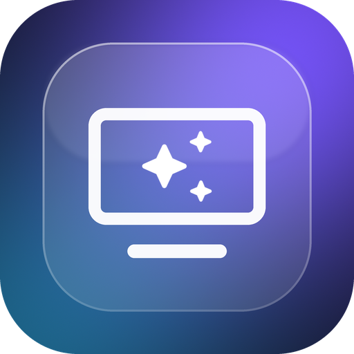
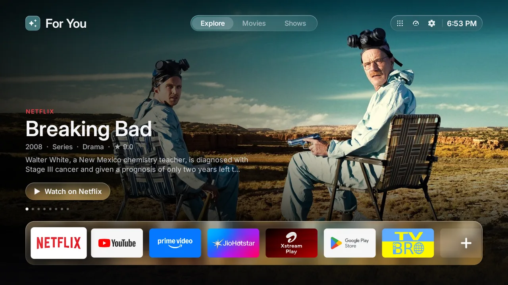

<div align="center">



# Glass TV

**An Apple TV style home screen for Android TV. Fast, ad-free, and made for 1 GB TVs.**

A full-screen featured title, your apps on a frosted glass dock, rows of what's popular on the
apps you already have, a performance tab with a memory cleaner, and clearer, louder sound.
No ads, no accounts, no tracking.

[](LICENSE)


[](https://claude.com/claude-code)

[Features](#features) · [Performance](#made-for-1-gb-tvs) · [Install](#install) ·
[Build from source](#build-from-source) · [Going back](#going-back)



</div>

---

## What is this?

Glass TV replaces the home screen of an Android TV (Google TV, Mi TV, TCL, Sony, Philips and
more) with one that looks and feels like Apple TV, and it's built to stay smooth on the cheap
1 GB TVs that most people actually own. It also turns off the TV maker's promo channels and
telemetry, frees memory for your apps, and makes dialogue easier to hear.

It started on my family's Xiaomi TV, which was laggy, full of ads and kept closing apps. It is
vibe coded with Claude: I decided what it should do and tested every change on the real TV,
and Claude wrote the Java. It builds on the open source [Free My TV](https://github.com/simbasjungles/free-my-tv)
(MIT), which does the safe home screen switch.

## Features

### A tvOS style home screen
- **Full-screen featured title.** The artwork fills the screen, uncropped, with the service,
  title, year, genre, rating, a two-line summary and a *Watch on* button. It loops through ten
  titles on its own, with a soft crossfade.
- **Frosted glass everywhere.** The top bar, the tabs, the dock and the buttons are glass that
  picks up the colors of the artwork behind it.
- **Explore, Movies and Shows** tabs, and the time, always at the top.
- **Dark only.** No bright white screens in a dark room.

### Recommendations from your own apps
- **Trending Now**, then **Top Shows** and **Top Movies** on each streaming app you have
  (Netflix, Prime Video, JioHotstar, Sony LIV), for your country, from [TMDB](https://www.themoviedb.org/).
- Nothing sponsored. Press OK on a title to open its app.

### Your apps, your way
- **Hold OK** on an app to pick it up: move it left or right, or press down to take it off Home.
- The **+** tile at the end of the dock lists the apps that aren't on Home yet. Press one to add it.
- **All Apps** has everything else, including Files, Gallery, TV Settings and Performance.

### Performance & Sound
- **Live memory and storage**, and **Free Up Memory**, which asks Android to close the apps
  waiting in the background (the app you're watching stays open).
- **Clear Voice:** lifts the speech frequencies and trims the boom, so dialogue is easy to follow.
- **Loud & Even:** a leveller with a limiter on the TV's whole sound output. Whispers come up,
  explosions and music come down, and every scene plays at one steady, loud level.

### No ads, no clutter
- Turns off the TV maker's promo channels, ad rows and telemetry apps (never uninstalls them).
- One button brings back the original home screen, exactly as it was.
- Pairs well with a lightweight browser like [TV Bro](https://github.com/truefedex/tv-bro),
  which blocks ads.

## Made for 1 GB TVs

Measured on a Xiaomi Mi TV (Amlogic, Android 9, 1 GB RAM, 720p UI):

| | Stock home screen | Glass TV |
|---|---|---|
| Home screen memory | 100 MB | about 40 MB |
| Free memory at rest | about 255 MB | about 400 MB |
| Home button response | 228 ms | 96 ms |
| Scrolling the rows | | 0 dropped frames, 9 to 12 ms a frame |

How:
- **One View, one Canvas.** No layouts, no WebView, no libraries. Nothing is redrawn while the screen is still.
- **Made ahead, off the UI thread.** Every card is pre-made at its exact size on screen, with its name on
  it, so a frame is one plain copy per card. The featured artwork comes with its shading baked in.
- **Glass without a GPU blur.** Android 9 can't blur in real time, so each title gets one tiny
  pre-blurred copy that every glass surface reads.
- **Gives memory back.** While an app or a movie is in front, the home screen keeps only what it
  needs to come back instantly. It rebuilds the app list only when an app is installed or removed.

## Install

Download `GlassTV-1.0.0.apk` from the [latest release](https://github.com/hussaintrawadi/glass-tv/releases/latest).
You need an Android TV (Android 8 or newer) and a computer with [adb](https://developer.android.com/tools/adb)
on the same Wi-Fi.

1. **On the TV:** Settings > Device Preferences > About, press *Build* seven times. Then
   Developer options > turn on **USB debugging**. Note the TV's IP address
   (Settings > Network & Internet).
2. **On the computer:**
   ```bash
   adb connect <TV IP>:5555
   adb install -r GlassTV-1.0.0.apk
   ```
   The TV asks *Allow USB debugging?* Tick *Always allow* and accept.
3. **On the TV:** open *Glass TV* > *Home Screen* > *Glass TV*. The TV asks once more to allow
   debugging, now for Glass TV itself (it uses the TV's own ADB to switch the home screen).

> **Recommendations need your own TMDB key.** The release build has none, so it shows a greeting
> instead of the rows. To get them, [build from source](#build-from-source) with your free key.

On a Mac, if `adb connect` says *No route to host* while the TV is on, macOS Local Network
privacy is blocking adb: allow your terminal in System Settings > Privacy & Security > Local Network.

## Build from source

You need a JDK 17+, the Android SDK command-line tools (build-tools 34, platform android-34) and adb.

```bash
git clone https://github.com/hussaintrawadi/glass-tv && cd glass-tv
./build.sh          # the first run creates config.properties
```

Open `config.properties` and set:
- `tmdb_key`: your free key from [themoviedb.org](https://www.themoviedb.org/settings/api) (Settings > API).
- `tmdb_region`: your country, two letters (`IN`, `US`, `GB`...).
- `latitude`, `longitude`, `city`: for the screensaver's weather.
- `brand_name`: the name shown on the TV, `Glass TV` by default.

Then `./build.sh` again and `adb install -r FreeMyTV.apk`. `config.properties` and your signing
key (`freemytv.keystore`) stay on your machine and are never committed. Keep the keystore:
updates must be signed with the same key.

## Going back

On the TV: *Glass TV* > *Home Screen* > *Original*. The original home screen, screensaver and
every app come back as they were. If the home screen ever crashes three times in five minutes,
it switches back by itself.

## Limitations

- Recommendations come from TMDB and need your own key (free). Airtel Xstream and YouTube aren't on TMDB.
- The sound modes work on the TV's own speakers and on most TVs; some TVs block apps from changing
  the main audio output, and then the modes have no effect.
- The LG (`webos/`) and Samsung (`tizen/`) versions come from Free My TV and don't have the new design.
- It's tuned for 720p and 1080p TV interfaces on Android 8 to 14.

## Project layout

| Path | What it is |
|---|---|
| [`TvHome.java`](app/src/io/freemytv/TvHome.java) | The home screen: banner, glass, dock, rows, All Apps |
| [`Rows.java`](app/src/io/freemytv/Rows.java) | Recommendations from TMDB, cached on disk, and the image cache |
| [`MonitorActivity.java`](app/src/io/freemytv/MonitorActivity.java) | Performance & Sound |
| [`SoundService.java`](app/src/io/freemytv/SoundService.java) | Clear Voice and Loud & Even |
| [`HomeMode.java`](app/src/io/freemytv/HomeMode.java) | The switch between Glass TV and the original home screen, and what it turns off |
| [`SettingsActivity.java`](app/src/io/freemytv/SettingsActivity.java) | The settings screen (the app's icon) |
| [`build.sh`](build.sh) | The build: aapt2, javac, d8, zipalign, apksigner. No Gradle |
| [`tools/`](tools) | Checks, translations, and the scripts that draw the icons |

## Privacy

No accounts, no analytics, no tracking. The app talks to TMDB (titles and images, with your
own key) and Open-Meteo (the screensaver's weather). It uses the TV's own ADB on 127.0.0.1 to
switch home screens, with a key you approve on the TV. Nothing listens to the network.

## Contributing

Issues and pull requests are welcome. Run `tools/check.sh` before you push: it builds the app
and checks the translations.

## Credits

- Built on [Free My TV](https://github.com/simbasjungles/free-my-tv) by the Free My TV contributors (MIT).
- This product uses the TMDB API but is not endorsed or certified by [TMDB](https://www.themoviedb.org/).
- Font: [Inter](https://rsms.me/inter/) (SIL OFL 1.1). Icons: [Material Symbols](https://fonts.google.com/icons) (Apache 2.0).
- Not affiliated with Apple, Google, Xiaomi or any streaming service. App names and artwork belong to their owners.

## License

[MIT](LICENSE). Free to use, change and share. Built by
[Hussain Trawadi](https://github.com/hussaintrawadi), vibe coded with [Claude](https://claude.com/claude-code).
